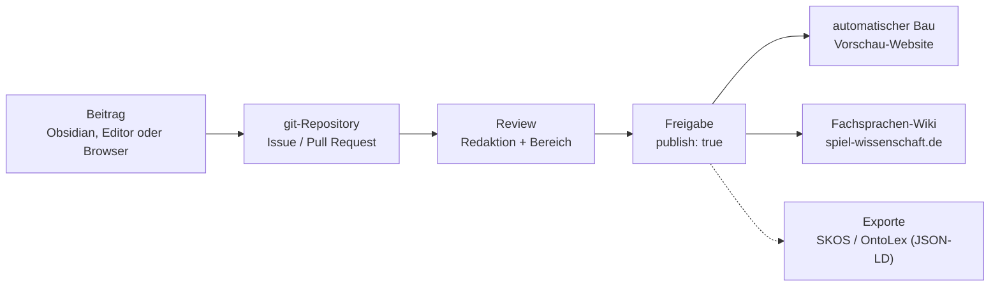

## Wie die Fachsprache entsteht

Die Fachsprache liegt als Ordner mit Textdateien in einem git-Repository, ohne Datenbank. Jeder Begriff ist eine Markdown-Datei; strukturierte Angaben (Benennungen, Status, Bereich, Quelle) stehen im Kopf der Datei (YAML-Frontmatter), der Fließtext darunter.

1. **Hier entsteht die Fachsprache.** Einträge werden im Repository geschrieben, diskutiert und freigegeben. Das Repository ist die einzige maßgebliche Fassung.
2. **Lokal spiegelbar.** Wer das Repository klont, hat die gesamte Fachsprache als Markdown-Vault, für Obsidian oder jedes andere Werkzeug.
3. **Ausgaben.** Aus freigegebenen Einträgen entstehen automatisch die Vorschau-Website und die Übernahme in das [Fachsprachen-Wiki der DGSW](https://www.spiel-wissenschaft.de/projekte/wiki/).

### Warum diese Form

- **Eine Quelle, mehrere Ausgaben.** Inhalt und Darstellung sind getrennt. Website, DGSW-Wiki und spätere Exporte werden aus denselben Dateien erzeugt und können nicht auseinanderlaufen.
- **Datenhoheit.** Reine Textdateien ohne Datenbank: Jede Kopie ist eine vollständige Fassung des aktuellen Stands, die ohne den Anbieter des Repositorys weiterverwendet und langfristig archiviert werden kann.
- **Nachvollziehbarkeit.** Jede Änderung ist mit Person, Zeitpunkt und Begründung dokumentiert (Commit, Diskussion im Pull Request). Geprüft wird vor der Veröffentlichung.
- **Zitierfähigkeit.** Jeder Stand ist eindeutig adressierbar. Eingefrorene Ausgaben je Release, mit DOI (z. B. über Zenodo), sorgen dafür, dass Zitate auf eine feste Fassung verweisen.
- **Wenig Betrieb.** Die Website ist statisch; es gibt keinen Server und keine Datenbank, die gewartet oder abgesichert werden muss. Das Projekt hängt damit nicht an einzelnen Personen oder Förderphasen.
- **Anschlussfähig.** Weil die Angaben strukturiert im Frontmatter stehen, lassen sich später Formate der Terminologiearbeit und des Semantic Web erzeugen (siehe *Standards*), ohne die Einträge neu zu schreiben.

### Grenzen

- git ist für viele ungewohnt. Deshalb gibt es drei Wege beizutragen, auch ganz ohne git (siehe [[Mitwirken]]).
- Es gibt keine Live-Bearbeitung wie in einem klassischen Wiki; Änderungen erscheinen erst nach Prüfung.

## Standards

Die Fachsprache orientiert sich an offen zugänglichen Standards der Wissensorganisation, insbesondere [W3C SKOS](https://www.w3.org/TR/skos-reference/) und [OntoLex-Lemon](https://www.w3.org/2016/05/ontolex/):

| Bereich | Bezug | Umsetzung hier |
| --- | --- | --- |
| Begriffe und Beziehungen | W3C SKOS | ein Eintrag pro Begriff; Beziehungen zwischen Begriffen als Links im Text |
| Zweisprachigkeit | OntoLex-Lemon (Modul *vartrans*) | Benennungen je Sprache, Äquivalenz voll / teilweise / keine |
| Austausch | SKOS / OntoLex-Lemon als JSON-LD | Export aus dem Frontmatter |
| Normdaten | Wikidata | optionales Feld `wikidata` mit der Q-Nummer des entsprechenden Wikidata-Eintrags |
| Belege | Wartungsbausteine der Wikipedia ("Belege fehlen", *citation needed*) | Wartungsmarke `belege-fehlen` |

Grundlage dieser Entscheidungen ist eine Konzeptstudie zu Datenmodell und Architektur eines interdisziplinären, zweisprachigen Fachsprachen-Wikis.

## Grundsätze

1. **Ein Eintrag pro Begriff.** Deutsche und englische Benennungen gehören zum selben Eintrag. Ein Wort mit zwei Bedeutungen bekommt zwei Einträge (z. B. "Spiel" als *game* und als *play*).
2. **Zweisprachig vollständig.** Jeder veröffentlichte Eintrag hat eine deutsche und eine englische Definition. Wo es keine etablierte deutsche Benennung gibt, wird das ausdrücklich vermerkt; eine Benennung wird nie erfunden.
3. **Dokumentieren vor Normieren.** Der Normalfall ist, den Sprachgebrauch in der Literatur mit mehreren belegten Definitionen darzustellen. Eine eigene Arbeitsdefinition der DGSW gibt es nur nach Abstimmung.
4. **Belegpflicht.** Jede Definition wird mit Quelle und Seite angegeben. Zitate werden am Original geprüft. Fehlt ein Beleg, wird das sichtbar markiert (siehe *Belegpflicht und Wartungsmarke*).
5. **Neutralität.** Konkurrierende Positionen werden fair und nebeneinander dargestellt; disziplinäre Unterschiede werden benannt und bleiben nebeneinander stehen.
6. **Analog und digital gleichwertig.** Definitionen, die nur für digitale Spiele gelten, werden als solche gekennzeichnet.

## Statusstufen

| Status | Bedeutung | veröffentlicht |
| --- | --- | --- |
| `entwurf` | in Arbeit | nein |
| `review` | wartet auf Prüfung durch Redaktion und Bereich | nein |
| `dokumentiert` | Sprachgebrauch belegt dargestellt | ja |
| `arbeitsdefinition` | abgestimmte Arbeitsdefinition der DGSW | ja |
| `veraltet` | nicht mehr empfohlen, mit Verweis auf Nachfolger | ja |

Veröffentlicht wird nur, was `publish: true` trägt. Die Redaktion setzt dieses Feld beim Übergang zu `dokumentiert` oder `arbeitsdefinition`.

Sobald ein Eintrag den Status `dokumentiert` oder `arbeitsdefinition` hat, wird die Infobox auf der Website ausgegraut: Der Eintrag ist abgeschlossen, die Redaktionsangaben treten zurück.

## Belegpflicht und Wartungsmarke

Unbelegte Definitionen werden sichtbar markiert, nach dem Vorbild der Wartungsbausteine der Wikipedia ("Belege fehlen" bzw. *citation needed*):

- **Schlagwort `belege-fehlen`** im Frontmatter: kennzeichnet den ganzen Eintrag. Die Website zeigt dann im Kopf die Marke **⚑ Belege fehlen**; alle betroffenen Einträge stehen auf der Schlagwortseite *belege-fehlen*.
- **Kasten** "Belege fehlen" über dem Eintrag: erscheint auf der Website automatisch, solange das Schlagwort gesetzt ist, und verschwindet mit ihm.
- **Inline** `*[Beleg fehlt]*` direkt hinter einer einzelnen unbelegten Aussage. Diese Marke steht nur in Einträgen mit gesetztem Schlagwort `belege-fehlen`; sie wird zusammen mit dem Schlagwort entfernt.

Neue Einträge aus der Vorlage tragen die Marke von Anfang an. Entfernt wird sie erst, wenn jede Definition Quelle und Seite hat und die Quelle in der [[Literatur|Literaturdatei]] steht. Ein Eintrag mit Wartungsmarke kann nicht den Status `dokumentiert` oder `arbeitsdefinition` erhalten.

## Aufbau eines Eintrags

Neue Einträge entstehen aus der Vorlage `vorlagen/Begriff.md` (in Obsidian: *Vorlage einfügen*). Pflichtteile: Benennungen, Definition (DE/EN), Oberbegriff, mindestens eine Quelle. Ein vollständig ausgefülltes Beispiel ist die [[Demo Vorlage]].

### Benennungen und Äquivalenz

Für jede Sprache: Vorzugsbenennung, weitere Benennungen (Synonyme, Abkürzungen) und die Äquivalenz zur deutschen Benennung:

- **voll** - Benennungen bezeichnen denselben Begriff
- **teilweise** - Begriffsumfang überschneidet sich nur
- **keine** - keine Entsprechung, Benennung wird übernommen oder umschrieben

### Definitionen schreiben

Eine Definition ist **ein Satz** nach dem Muster *Oberbegriff + unterscheidende Merkmale* ("Ein Serious Game ist ein Spiel, das ..."). Keine Beispiele, keine Wertungen, keine Zirkeldefinition. Erläuterungen gehören in *Abgrenzung* oder *Anmerkungen*.

### Eintragstyp

Nicht alles, was die Fachsprache erklärt, ist ein Begriff im terminologischen Sinn. Das Feld `typ` im Frontmatter hält das fest:

| Typ | Bedeutung | Beispiel |
| --- | --- | --- |
| `begriff` | Standard: ein Konzept mit einer Definition | [[Immersion]] |
| `modell` | ein Modell oder eine Typologie | [[Spielertypen nach Bartle]] |
| `werk` | ein einzelnes Werk, das als Begriff gebraucht wird | [[Homo Ludens]] |
| `rolle` | eine Berufsrolle oder Tätigkeit | [[Tech Artist]] |
| `forschungsfeld` | ein Fach oder Forschungsfeld | [[Ludologie]] |

Einträge mit einem anderen Typ als `begriff` tragen den Typ als Marke im Kopf der Seite. Die Definition ist dann entsprechend gefasst ("Ein Modell ist ...").

### Oberbegriff

Jeder Eintrag nennt einen Oberbegriff: im Definitionssatz und im Feld `oberbegriff`, als Link in Anführungszeichen (`oberbegriff: "[[Spiel]]"`). Das Feld darf in den Status `entwurf` und `review` leer sein; ab `dokumentiert` ist es Pflicht. Der Oberbegriff erscheint in der Infobox und dient später dem Export (SKOS *broader*).

### Wikidata

Das Feld `wikidata` ist optional. Es enthält die Q-Nummer des entsprechenden Wikidata-Eintrags (`wikidata: Q12345`) und erscheint als Link in der Infobox. Ein Eintrag bekommt die Nummer nur, wenn der Wikidata-Eintrag denselben Begriff meint.

### Beziehungen

Beziehungen zwischen Begriffen stehen als Links im Fließtext (*Abgrenzung*, *Anmerkungen*); eine eigene Liste gibt es nicht. Jeder Link erzeugt automatisch einen Rückverweis beim verlinkten Begriff und eine Kante im Graphen. Wird ein Begriff erwähnt, für den es einen Eintrag gibt, wird er beim ersten Vorkommen verlinkt.

### Bereich

Jeder Eintrag wird mindestens einem Bereich zugeordnet, als Schlagwort (`bereich/durch-spiele`) und erscheint so in der Infobox, die die Website aus dem Frontmatter erzeugt (Status, Bereich, Betreuung): [[fuer-spiele|FÜR Spiele]], [[ueber-spiele|ÜBER Spiele]], [[durch-spiele|DURCH Spiele]], [[mit-spielen|MIT Spielen]], [[fundament|Fundament]].

### Schlagwörter (Tags)

Schlagwörter dienen der Ordnung und der Redaktion. Inhaltliche Vernetzung läuft über Links. Es gibt nur drei Arten; andere Schlagwörter werden nicht vergeben:

| Art | Form | Pflicht | Zweck |
| --- | --- | --- | --- |
| **Bereich** | `bereich/fuer-spiele`, `bereich/ueber-spiele`, `bereich/durch-spiele`, `bereich/mit-spielen`, `bereich/fundament` | ja, mindestens eines | Zuordnung zu den Bereichen der DGSW; steuert Farbe, Graph und Bereichsseiten |
| **Schirmkategorie** | `kategorie/…`, z. B. `kategorie/spielpsychologie` | nein, höchstens eine bis zwei | grobe fachliche Gruppe innerhalb eines Bereichs (z. B. die Kategorien des DGSW-Wikis) |
| **Wartung** | `belege-fehlen` | nach Bedarf | Redaktionsstand, z. B. fehlende Belege |

Keine Themen- oder Stichwort-Tags (etwa `thema/unity`, `thema/motivation`): Was mit einem Begriff zusammenhängt, wird als Link im Text ausgedrückt. Links erzeugen Rückverweise und Graph-Kanten von selbst; Stichwort-Tags würden dieselbe Information ein zweites Mal und ungeordnet führen. Die Liste der Schirmkategorien ist offen und wird von der Redaktion gepflegt.

## Kennung (ID)

Jeder Begriffseintrag trägt im Frontmatter eine eindeutige, fortlaufende Kennung, z. B. `id: "0042"`. Andere Seiten (Bereiche, Leitfaden, Startseite) haben keine.

- Die ID ist die feste Identität des Begriffs. Sie ändert sich nie, auch wenn der Eintrag umbenannt wird, und wird nie wiederverwendet, auch nicht bei `veraltet`.
- Der Dateiname bleibt der lesbare Name des Begriffs; die ID dient zum Zitieren, für Exporte und als Anker bei Umbenennungen.
- Neue Einträge starten mit leerem Feld `id`. Die Redaktion vergibt die nächste freie Nummer, wenn sie den Eintrag zur Veröffentlichung freigibt.
- Die Nummer `0000` ist für die [[Demo Vorlage]] reserviert; fortlaufende Nummern beginnen bei `0001`.
- Die Übersicht (`redaktion/Übersicht.base`) zeigt die ID als erste Spalte.

## Datumsfelder

Die Startseite zeigt die zuletzt angelegten oder bearbeiteten Einträge. Dafür tragen Einträge zwei Felder im Frontmatter:

- `created` - Zeitpunkt, an dem der Eintrag angelegt wurde, als Datum mit Uhrzeit (`JJJJ-MM-TTThh:mm`, die Vorlage setzt es automatisch).
- `modified` - Zeitpunkt der letzten inhaltlichen Änderung im selben Format. Wer einen Eintrag bearbeitet, trägt hier den aktuellen Zeitpunkt ein. Ist das Feld leer, gilt `created`.

Die Uhrzeit entscheidet die Reihenfolge, wenn mehrere Einträge am selben Tag angelegt oder bearbeitet wurden. Ein reines Datum (`JJJJ-MM-TT`) ist ebenfalls zulässig.

## Dateinamen

- Dateiname = deutsche Vorzugsbenennung, im Singular (`Serious Game.md`, nicht `Serious Games.md`). Der Titel (`title`) im Frontmatter ist identisch mit dem Dateinamen.
- Gibt es keine etablierte deutsche Benennung, gilt die englische.
- Bei mehrdeutigen Wörtern ein Zusatz in Klammern: `Spiel (Artefakt).md`.
- Plural, englische Formen und Abkürzungen kommen in `aliases`, damit Links in beiden Sprachen funktionieren.

## Rollen

- **Redaktion** - achtet auf Einheitlichkeit, Belege und Standards, gibt zur Veröffentlichung frei.
- **Bereichsbetreuung** - je Bereich Verantwortliche aus den AGs; prüfen fachlich.
- **Beitragende** - alle Mitglieder; schlagen Einträge und Änderungen vor.

Eine Änderung an einer Arbeitsdefinition braucht die Freigabe von Redaktion **und** Bereichsbetreuung.
